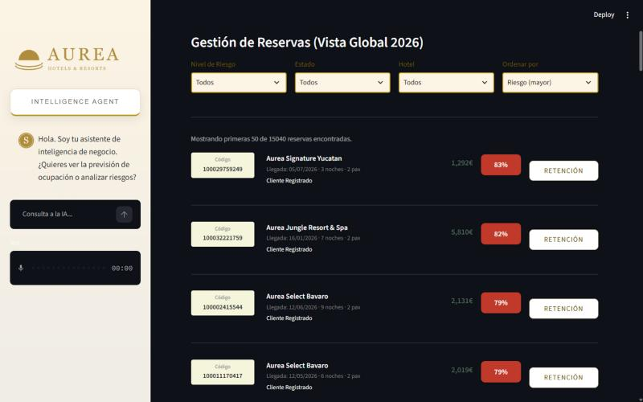
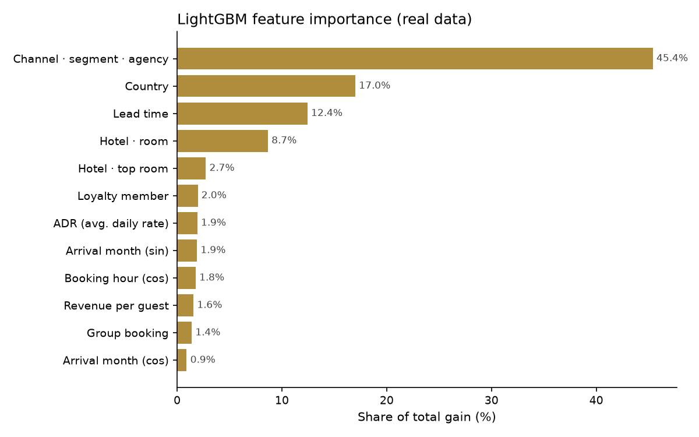
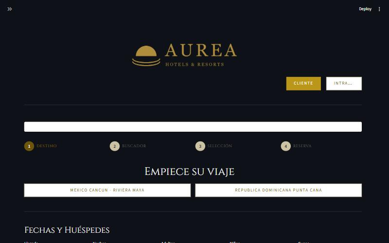
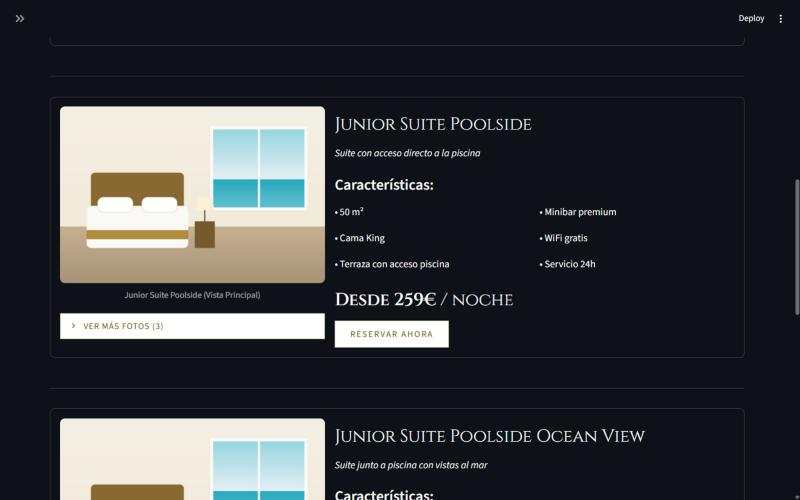
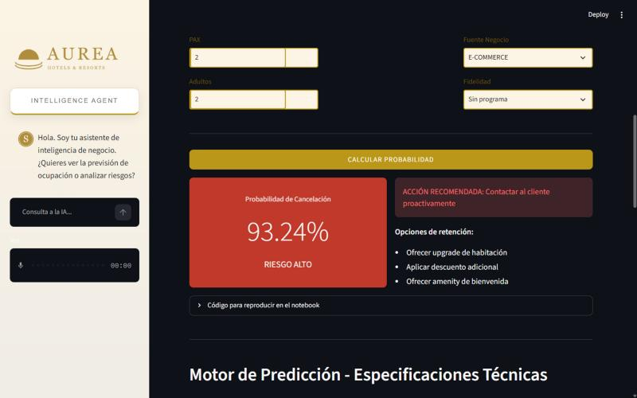
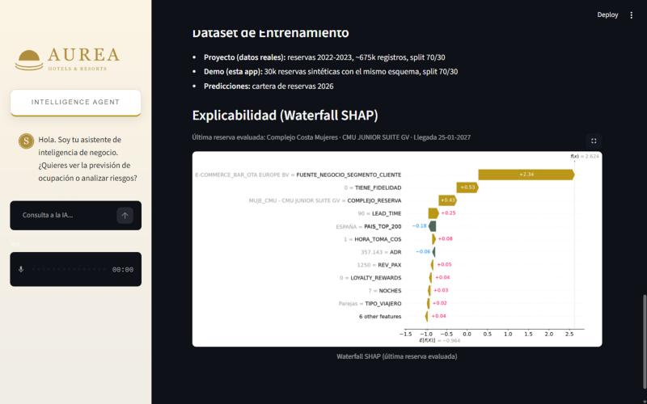

# Hotel Booking Cancellation Prediction

> End-to-end ML project: from raw booking data to an explainable LightGBM model served in a Streamlit app with an LLM assistant.
> Master's thesis (TFM) · Master in Data Science & Generative AI · 2026

[](https://www.python.org/)
[](https://lightgbm.readthedocs.io/)
[](https://streamlit.io/)
[](https://shap.readthedocs.io/)

We built a model that scores every new booking with its probability of being cancelled. The model runs inside a web app with two sides:
- **Booking site:** customers book a room, and every new booking is scored as it is made.
- **Revenue intranet:** staff see bookings ranked by risk, the SHAP explanation for each prediction, and one-click retention actions.

<!-- Live demo: add your Streamlit Cloud URL here once deployed -->



> **About the data and the brand.** The project was built for a real hotel group, whose data is confidential.
> - The brand ("Aurea Hotels & Resorts"), the hotels, the images and every dataset in this repo are **fictional or synthetic**.
> - The results in section 4 were measured on the real data.
> - The model shipped with the app is retrained on synthetic data.

---

## 1. Business problem

Cancellations are one of the hotel industry's biggest operational risks. Every booking cancelled at the last minute is a room that stays empty. To make up for it, hotels overbook blindly.

The client wanted to move from **reactive** cancellation handling to a **preventive, data-driven** approach for its three highest-revenue resort complexes in the Caribbean: Costa Mujeres and Riviera Maya in Mexico, and Punta Cana in the Dominican Republic.

**Goal:** score each booking as soon as it is made, so the hotel can:
- adjust controlled overbooking;
- send targeted retention offers to high-risk bookings.

**Key metric:** recall on the *cancelled* class. A missed cancellation (false negative) means an empty room. A false alarm only costs an unnecessary retention offer.

## 2. Data

- **Source:** transactional bookings from the client's reservation system for **2022–2023**, enriched with room, hotel and loyalty catalogs.
- **Size:** about **675k bookings** and about 60 raw and engineered variables.
- **Target:** about 37% of the bookings were cancelled.

The real data is not part of this repository. [`src/generate_synthetic_data.py`](src/generate_synthetic_data.py) creates **synthetic datasets with the same schema**, so the app and the notebooks run end to end. See [`data/README.md`](data/README.md).

## 3. Methodology

```
Raw bookings ─► Cleaning & EDA ─► Feature engineering ─► Model benchmark ─► Optuna tuning ─► SHAP ─► Streamlit app
```

1. **EDA & cleaning** ([`notebooks/01_eda.ipynb`](notebooks/01_eda.ipynb)):
   - Removed inconsistent stays (zero nights, negative values) and normalised room and hotel names.
   - Ran univariate and bivariate analysis against the target, looked at cancellations over time, and compared the hotels.
2. **Feature engineering** ([`src/funciones_produccion.py`](src/funciones_produccion.py)):
   - **Price features:** `ADR` and revenue per guest.
   - **Booking-window features:** `LEAD_TIME`, plus cyclical (sine/cosine) encodings of the booking hour and the arrival month.
   - **Guest features:** traveller type, group flag, loyalty membership, and a top-200 country grouping.
   - **Combined categories:** channel × segment × agency, and hotel × room.
3. **Modelling** ([`notebooks/02_modeling.ipynb`](notebooks/02_modeling.ipynb)):
   - **Benchmark:** Logistic Regression, Random Forest, XGBoost, CatBoost and LightGBM.
   - **Feature selection:** based on feature importance and SHAP values.
   - **Final model:** **LightGBM** with native categorical features and `is_unbalance=True`. Hyperparameters were tuned with **Optuna** on a 70/30 split.
4. **Explainability** ([`notebooks/04_shap_waterfall.ipynb`](notebooks/04_shap_waterfall.ipynb)): a SHAP waterfall explains each individual prediction, both in the notebook and inside the intranet.
5. **Production** ([`app/`](app)): a Streamlit multipage app that:
   - rebuilds the features from the booking form;
   - scores the booking in real time;
   - recommends a retention action.

## 4. Results (real data, test set of 202,494 bookings)

| Metric | Value |
|---|---|
| **ROC AUC** | **0.870** |
| **Recall (cancelled)** | **80.1%** |
| **Accuracy** | **77.55%** |
| Precision (cancelled) | 66.5% |
| F1 (cancelled) | 0.727 |
| Average precision | 0.802 |

The model catches **4 out of 5 cancellations** before they happen. The strongest drivers are the distribution channel / segment / agency combination, the guest's country and the lead time:

<p align="center"></p>

Full metrics and hyperparameters: [`docs/real_data_results.json`](docs/real_data_results.json).

The demo model in [`models/`](models) uses the same pipeline and hyperparameters, but it is trained on synthetic data. Its metrics are in [`models/metrics.json`](models/metrics.json) and only show that the pipeline works.

## 5. The app

| Booking site | Room selection with dynamic pricing |
|---|---|
|  |  |
| **Intranet – manual what-if prediction** | **Intranet – SHAP explanation** |
|  |  |

- **Booking flow:**
  - Choose a destination, hotel and room.
  - Prices come from a weekly ADR table.
  - Every new booking is scored by the model straight away.
- **Intranet:**
  - Search a booking, or browse the 2026 booking book ranked by risk.
  - Run what-if predictions with a SHAP waterfall.
  - Use the occupancy / overbooking control.
  - Send a retention offer in one click (optionally by Telegram).
- **"Sophie" AI assistant:** an LLM agent (Groq · Llama 3.1) with text-to-speech. It answers questions about hotels, bookings and risk.

## 6. Run it locally

```bash
git clone https://github.com/Pepejmart/hotel-cancellation-prediction.git
cd hotel-cancellation-prediction

python -m venv .venv
source .venv/bin/activate          # Windows: .venv\Scripts\activate
pip install -r requirements.txt

streamlit run app/app.py
```

- **Data:** on first launch the app generates the synthetic data in `data/`. You can also run `python src/generate_synthetic_data.py` yourself.
- **Model:** to retrain the demo model, run `python src/train_model.py`.
- **Secrets:** the app works without any. To enable the AI assistant, Telegram notifications or Google Sheets persistence, copy `app/.streamlit/secrets.example.toml` to `app/.streamlit/secrets.toml` and fill in your own keys.
- **Notebooks:** install `requirements-dev.txt`. They were originally run against the real data. Point their data paths at `data/df_unificado_completo_v8.csv` to use the synthetic version.

### Deploy on Streamlit Community Cloud

1. Push this repository to your GitHub account.
2. On [share.streamlit.io](https://share.streamlit.io), click **Create app**, pick the repo and branch, and set the main file to `app/app.py`.
3. Under *Advanced settings*:
   - choose Python 3.12;
   - optionally paste the content of `secrets.example.toml` with your keys.
4. Deploy. The synthetic data is generated automatically on the first run.

## 7. Repository structure

```
├── app/                         Streamlit application
│   ├── app.py                   Booking site (entry point)
│   ├── pages/1_Intranet.py      Revenue-management intranet
│   ├── agent_v2.py              "Sophie" LLM assistant (Groq)
│   ├── utils.py                 Model loading + inference-time feature engineering
│   ├── bootstrap.py             Generates synthetic data on first run
│   ├── precios_data.py          Loads the ADR price table
│   ├── google_sheets_store.py   Optional persistence in Google Sheets
│   ├── media/                   Illustrations generated for the demo
│   └── .streamlit/              Theme config + secrets template
├── src/
│   ├── funciones_produccion.py      Feature-engineering functions
│   ├── generate_synthetic_data.py   Synthetic dataset generator
│   └── train_model.py               Trains the demo model
├── notebooks/                   EDA, modelling, prediction demo, SHAP
├── models/                      Demo LightGBM model + metrics
├── data/                        Generated locally (git-ignored); see data/README.md
└── docs/                        Real-data results, images, integration notes
```

## 8. Team

Group 4, Master in Data Science & Generative AI:

- Alejandro Batres Arnal
- David Ostiz Fenoll
- Francisco Javier Barrionuevo Garzón
- Gabriel Chamorro Sánchez
- José Javier Martínez Camacho

## Disclaimer

This is an academic project. All brand names, hotels, images and data in this repository are fictional or synthetic. Any resemblance to real companies is coincidental.
